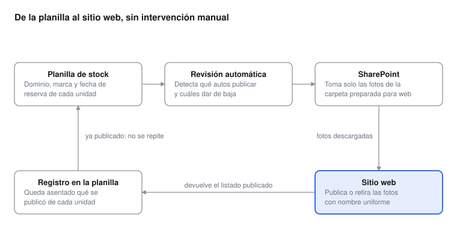

# Automatización de fotos de usados

Oct 19, 2026 · Guillermo Volpe

## Resumen

Se automatizó la publicación de las fotos de autos usados en el sitio web.

Un Apps Script en la planilla de stock llama a un proceso de n8n. El proceso busca en SharePoint la carpeta que tenga el número de patente, toma las fotos de la subcarpeta WebKai, las copia por FTP al sitio de Kansai y devuelve los nombres de los archivos, que quedan registrados en la misma planilla.

Cuando el auto se reserva, el proceso borra esas fotos del sitio.

Antes era una tarea manual: bajar las fotos de SharePoint, renombrarlas una por una y subirlas por FTP.

---

## Resumen ejecutivo

La publicación de las fotos de autos usados en el sitio web pasó a ser automática: ya no requiere carga manual.

El circuito se dispara desde la planilla de stock que Comercial ya usa. El proceso busca las fotos en SharePoint, las renombra con un criterio uniforme y las publica en el sitio. Cuando el auto se reserva, retira sus fotos automáticamente.

Qué aporta:

- **Menos trabajo operativo.** Se elimina la subida manual de fotos al servidor, auto por auto.
- **Catálogo al día.** Las fotos aparecen y se dan de baja siguiendo el estado real del stock.
- **Sin unidades no disponibles.** Un auto reservado deja de mostrar fotos sin que nadie intervenga.
- **Calidad uniforme.** Solo se publican las fotos de la carpeta preparada para web, con el tamaño correcto.

## Situación anterior

Publicar las fotos de una unidad era una tarea manual y repetitiva, con varios puntos de falla.

Por cada auto había que entrar a SharePoint, ubicar la carpeta de la unidad dentro de la marca, abrir la subcarpeta con las fotos preparadas para web, descargarlas, renombrarlas una por una siguiendo la convención del sitio y subirlas por FTP al servidor.

Esto traía tres problemas recurrentes:

- **Demora entre el ingreso del auto y su aparición en la web**, por depender de que alguien hiciera la tarea.
- **Fotos de autos ya reservados que seguían publicadas**, porque dar de baja era otra tarea manual que se postergaba.
- **Errores de nombrado**, que hacían que una foto no se mostrara en el sitio.

## Cómo funciona el circuito

**Circuito, paso a paso:**

1. **Planilla de stock** — Comercial carga el dominio, la marca y la fecha de reserva.
2. **Revisión automática** — detecta qué autos hay que publicar y cuáles dar de baja.
3. **SharePoint** — toma solo las fotos de la carpeta preparada para web (WebKai).
4. **Sitio web** — publica o retira las fotos, renombradas con un criterio uniforme.
5. **Registro en la planilla** — queda asentado qué se publicó de cada unidad.

El proceso corre solo cada cierto tiempo. Lee la planilla, resuelve qué unidades necesitan acción y deja el resultado asentado en la misma planilla, que es de donde el catálogo publicado toma el listado. Como el resultado queda registrado, una unidad ya publicada no se vuelve a procesar en las corridas siguientes.

## Reglas de negocio automatizadas

Todo se decide a partir de dos datos que Comercial ya carga en la planilla: el **dominio** del auto y su **fecha de reserva**.

| Situación del auto en la planilla | Acción automática |
| --- | --- |
| Disponible y aún sin fotos publicadas | Publica las fotos en el sitio y deja el listado registrado en la planilla |
| Se le carga una fecha de reserva | Retira sus fotos del sitio |
| Ya tiene fotos publicadas y sigue disponible | No hace nada |
| Sin fotos cargadas en SharePoint | Deja el registro vacío, sin publicar nada |

Dos criterios de diseño relevantes para el negocio:

- **Solo se publican las fotos de la carpeta preparada para web.** Si esa carpeta no existe para una unidad, el proceso no publica nada en vez de tomar imágenes de otro lado. Es una decisión deliberada para no subir fotos con el tamaño equivocado.
- **El nombre de la marca tolera errores de tipeo.** Si en la planilla figura una variante mal escrita, el proceso igual encuentra la carpeta correcta.

## Seguridad y control

El proceso corre sobre la infraestructura propia de Kansai y no expone credenciales en el código.

- **Acceso restringido.** El punto de entrada del proceso exige una clave compartida. Un pedido sin esa clave se rechaza antes de ejecutar nada.
- **Credenciales centralizadas.** Los accesos a SharePoint y al servidor web se administran desde el gestor de credenciales de la plataforma de automatización, no dentro del código ni en planillas.
- **Permisos acotados.** El usuario del servidor web solo puede escribir en la carpeta de fotos de usados; no alcanza al resto del sitio.
- **Lectura únicamente en SharePoint.** El proceso descarga las fotos pero nunca modifica ni borra nada en SharePoint.
- **Trazabilidad.** Cada ejecución queda registrada, con el detalle de qué unidades se publicaron, cuáles no tenían fotos y si hubo errores de comunicación.

## Estado actual y próximos pasos

El circuito está construido y probado de punta a punta: se validó la búsqueda en SharePoint, la publicación de fotos en el sitio, la baja de fotos y el registro en la planilla.

Queda pendiente para dejarlo en régimen:

- [ ] Activar la ejecución automática periódica, para que corra sin que nadie la dispare
- [ ] Rotar la clave de acceso del proceso, por buena práctica antes de la puesta en producción
- [ ] Validar la copia del listado de fotos al catálogo publicado

Dos puntos a tener en cuenta para la operación:

- **Depende de que las fotos estén en SharePoint con la estructura de carpetas acordada.** Si una unidad no tiene su carpeta preparada para web, no se publica. El proceso lo informa, pero la carga de las fotos sigue siendo responsabilidad de quien las toma.
- **Las fotos se publican una sola vez por unidad.** Si después se agregan o cambian fotos en SharePoint, hay que pedir explícitamente la actualización de esa unidad.
